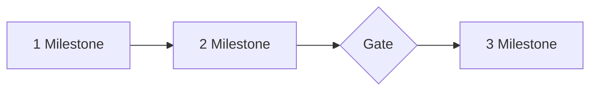
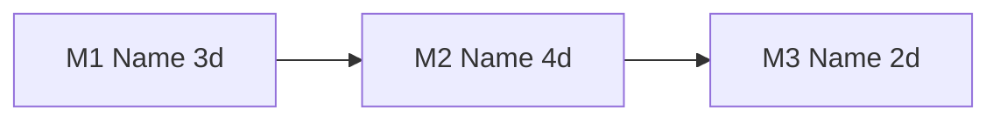

# [Project Name] — Effort Estimate v[0.1]

[One line of scope] · Drafted [date] · Status: draft for engineer sign-off · [Replaces v__, if any]

> Core sections 1 to 5 are always present. Sections 6 to 9 are supporting: omit any that do not apply. Numbers match the HTML file exactly.

## Delivery days

| Delivery days | Heads-down | Buffer 20% | Calendar days (÷ 0.7) | Human-led share | Confidence |
| :---: | :---: | :---: | :---: | :---: | :---: |
| **[X]** | [X] | [X] | [X ÷ 0.7] | [N%] | [level] |

| # | Milestone | Heads-down | Buffer 20% | Delivery days | Calendar days | Running total |
| :---: | :--- | :---: | :---: | :---: | :---: | :---: |
| M1 | [Name] | [X] | [0.2 × core] | [sum] | [sum ÷ 0.7] | Day [N] |
| | Rollout (general allowance, not tied to a milestone) | n/a | n/a | 2.0 | [2.0 ÷ 0.7] | Day [N] |
| | **Total** | [X] | [X] | **[sum + 2.0]** | **[sum ÷ 0.7]** | |

**What the added columns mean**
- **Buffer:** 20% of core engineering days only (not setup), for rework, surprises, and bot output needing more review than planned.
- **Rollout:** a single 2-day general allowance for cutover, UAT preparation, and training material. It is added once at the end, not to any milestone. *[assumed]*
- **Calendar days:** delivery days ÷ 0.7. Assumption to calibrate.
- **Assumed to run in parallel, so not added:** security and compliance review handling (preparing write-ups, answering Legal and Security questions, fixing findings) and engagement with [stakeholder teams] (working sessions, demos, UAT, reconciliation reviews, sign-off walkthroughs). They are assumed to happen alongside heads-down work and not to extend it. *[assumed]* If they turn out to block the engineer, add that time back.
- **Not included:** the reviewers' own elapsed time ([name the reviews and assumed durations if known]), other teams' queue time, vendor replies, pilot run time. If a review runs past its assumed duration, the dates move day for day.

A bot writes the code and tests. Heads-down days are the human engineer's time: directing the bot, reviewing, validating against real data, and setup. The milestone sections below show heads-down days only.

---

## 1. Problem statement

[2–3 sentences, plain language: who has the problem, what it costs, why now.] *[SAID source]*

| What is blocked or painful today | What success looks like |
| :--- | :--- |
| [Constraint or pain] | [Measurable outcome] |

---

## 2. Solution approach

**[One sentence: the approach.]** [1–2 sentences: how it is built and why in these steps.]

**Main risk accepted:** [One honest sentence.] *[inferred]*

Possible approach, not a confirmed design. Alternatives considered: [name, one line each]. Out of scope: [list].

---

## 3. Requirements

### User stories

- **[Role]:** I want [action] so that [outcome].

### Functional requirements

| Area | What the product does | Spec IDs | Milestone |
| :--- | :--- | :---: | :---: |
| [Area] | [Observable behavior] | R-1 | M1 |
| Guardrails | [Non-negotiable constraints] | R-n | All |

Undefined in the spec and carried as open items: [list]. Until defined, [what the estimate assumes].

---

## 4. Architecture, tl;dr

**[One sentence: what is new, what is reused.]**

NEW = new work · REUSE = copies an existing pattern.

### What we found in the repos

| Piece | Existing precedent | What it means |
| :--- | :--- | :--- |
| [Piece of work] | `[repo]` `[path]`: [what it does] | [Copy / adapt / no precedent found] *[inferred]* |

### Watch out

[The one technical behavior most likely to cause silent errors or surprise, and what the plan does about it. Omit if none.] *[evidence tag]*

### Choices still open

- **[Choice]:** [option A] vs. [option B]. Lean: [which, why]. Possible approach, not a decision.

---

## 5. Estimates

Heads-down engineering days, bot writes the code. No buffer here (see Delivery days above); review handling and engagement are assumed parallel; no waits or decisions. Running total is cumulative heads-down days.

| # | Milestone | Stakeholder can… | Core | Setup | Days | Running total | Complexity | Confidence |
| :---: | :--- | :--- | :---: | :---: | :---: | :---: | :---: | :---: |
| M1 | [Name] | [What they can now do] | [X] | [X] | [sum] | Day [N] | Low/Med/High | High/Med/Low |
| | *[Optional gate: decision before further investment; no days]* | | | | | | | |
| | **Total** | | [X] | [X] | **[sum]** | | | |

### M1 — [Milestone name] · [X] days ([X] core · [X] setup)

**Outcome:** [What the named stakeholder can use, tied to an acceptance criterion.] [Sign-off needed before it goes live, if any.]

**Complexity: [Low/Medium/High]** — [one line on what makes it this complexity.]

**Why these days**
- **[Factor] ([X]).** [Why it adds or removes days; pattern path if one exists.] *[evidence]*
- **[Factor] ([X]).** [...]

**What would change it:** [If X: about +N days. If Y: about -N days.]

| Technical change, in plain language | Who | Days |
| :--- | :---: | :---: |
| [Human-readable change, following `[pattern path]`] | Bot drafts, you review | [X] |
| Setup: [access, infra, config] | Ops | [X] |
| | | **[sum = milestone days]** |

### M2 — [Milestone name]

[Same structure as M1.]

### How this compares with v[previous]

[Only when a previous estimate exists: what moved and why, with old and new totals.]

---

## 6. What moves the numbers

| If this turns out true… | Effect | Milestone | Evidence |
| :--- | :--- | :---: | :---: |
| [Assumption or risk] | [About +N / -N days, and what else changes] | M1 | assumed |

### Decisions that unlock the most work

- **[Decision]:** [what it unlocks, e.g. N tasks become bot-ready]. [Who decides.]

Decisions are prerequisites, not estimated work. Not in any number above: waits ([name the known ones and who they depend on]) and the reviewers' own time. Each can move the dates.

---

## 7. Open questions to validate with the team

> **Timeline dependency.** [Any other team's availability or ownership the plan relies on. A wait, not engineering days. State what is unconfirmed.]

**Q1. [Question the team must answer]**
[Answer as far as the repos show it, with file or table names.] *[from repo]*
*To confirm with the team:* [the part the repos cannot answer].

**Q2. What changes do we need from [other team]?**

| Change | Where | Milestone |
| :--- | :--- | :---: |
| [Change] | `[repo or system]` | M1 |

Roughly [N] of the [X] days sit in systems owned or reviewed by [team]. This is a split from the task lines, not a team commitment. *[assumed]*

---

## 8. Sources and what I could not verify

- **Documents:** [spec, TDD, transcript, with versions]
- **Repos read:** `[repo]`: [what was used]
- **Not verified:** [inferred without seeing code, commands not confirmed, vendor claims not checked]. Read access only; no tests were run.
- **Calibration:** after M1, record the bot's actual draft quality, review time, rework passes, and tasks that needed more than review, then re-run before committing later milestones.

---

## 9. Later phase preview (optional, not estimated)

[Why it is not estimated, when it would start, the shape of it as a short flow, where the human effort will go, and open questions for its spec.]
