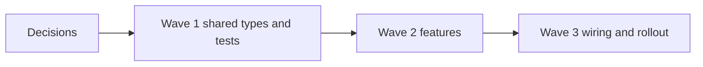
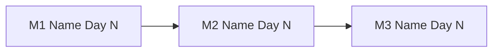

# Effort Breakdown Analysis - [Project Name]

**Date:** [Today's Date]
**Status:** Draft — Awaiting Engineer Sign-off
**Prepared by:** [Author / Team]

---

## Table of Contents

- [Executive Summary](#executive-summary)
- [Requirements](#requirements)
- [Approach](#approach)
- [Decisions That Unlock the Most Work](#decisions-that-unlock-the-most-work)
- [RAD Analysis](#rad-analysis)
- [Execution Plan](#execution-plan)
- [Tasks](#tasks)
- [Milestones](#milestones)
- [Bottom-up Task Table](#bottom-up-task-table)
- [Wait-Time Assumptions](#wait-time-assumptions)
- [Calibration Plan](#calibration-plan)
- [What I Could Not Verify](#what-i-could-not-verify)

---

## Executive Summary

> Written for PMs and senior leadership. No repo names. No technical jargon.

[1–2 sentences: what is being built, why it matters to the business, and which solution approach was chosen.]

| | |
| :--- | :--- |
| **Business Goal** | [e.g. Reduce checkout drop-off by 15%] |
| **Chosen Approach** | [Solution name — one sentence on what it is] |
| **Success Criteria** | [How we'll know this is done] |
| **Business Systems Affected** | [Plain-language names — e.g. Checkout Flow, Payment Processing] |
| **Work Sorted** | [N tasks: x agent-ready (A), y A with focused review (A*), z human-led (B). Share in A: __% by count, __% by effort] |
| **Core Engineering** | [X days raw] + [Y days 20% buffer] = [Z days] |
| **Operational** | [X days — setup, infra, access] |
| **Rollout** | [X days — demos, reconciliation, UAT, training] |
| **Total Focused Days** | [Core Engineering incl. buffer + Operational + Rollout] |
| **Calendar Working Days** | [Total focused ÷ 0.7 focus factor] |
| **Final Milestone Date** | [Day N — running total of calendar working days from day 0; excludes waiting and decision time] |
| **Overall Confidence** | [High / Medium / Low] |
| **Risk Summary** | [One sentence. Review delays (Legal, Security) are the biggest schedule risk — see Wait-Time Assumptions. e.g. "One milestone also carries high risk due to legacy auth layer."] |
| **Key Assumptions** | [e.g. "Staging access available; v2 payments endpoint is idempotent"] |
| **Hard Dependencies** | [e.g. "Payment service schema migration must complete before M2"] |

---

## Requirements

> The agreed-upon problem definition. Locked before solutions were evaluated.

### Use Cases

| Actor | Action | Goal |
| :--- | :--- | :--- |
| [e.g. Logged-in user] | [e.g. Saves payment method at checkout] | [e.g. Faster repeat purchases] |

### User Stories

- As a [role], I want to [action] so that [outcome].

### Acceptance Criteria

- [ ] [Specific, testable condition — e.g. "Payment method saved successfully shows confirmation within 2s"]
- [ ] [...]

### Success Metrics

- [Measurable outcome — e.g. "Checkout completion rate ≥ 85% in staging load test"]

### Constraints

- [Non-negotiable — e.g. "Must not store raw card data — use tokenization only"]

### Scope

**In scope:**
- [Feature or capability included in this phase]

**Out of scope:**
- [Adjacent thing explicitly excluded — e.g. "Admin reporting dashboard (Phase 2)"]

---

## Approach

> Taken from the technical structure. In `--lite` mode, a brief solution check instead (two candidates, one recommendation).

**Chosen approach:** [Name and one sentence.]
**Source:** [Technical structure v__ / lite-mode solution check]
**Main risk accepted:** [One honest sentence.]

**Repo / service impact:**
- `[repo/service]` — [what changes]

*(Lite mode only)* **Alternative considered:** [Name, one line, why not chosen.]

---

## Decisions That Unlock the Most Work

> Open decisions are prerequisites. They carry no estimated time; meetings and alignment are outside this estimate.

| Decision | Spec ID | Tasks it moves from B to A | Who decides | Needed by wave |
| :--- | :---: | :---: | :--- | :---: |
| [e.g. D-2: sync vs async send] | R-4 | [N] | [PM / Eng] | 1 |

---

## RAD Analysis

> The "no surprises" section. Source column shows where each item came from. Tasks column shows which tasks it affects.

### Risks

| Risk | Source | Tasks Affected | Affected Milestone | Mitigation |
| :--- | :---: | :---: | :---: | :--- |
| [Description] | Transcript / Spec / Engineer | [IDs] | M[N] | [Concrete step — e.g. "Spike 1 day on legacy auth before M1 is locked"] |

### Assumptions

| Assumption | Source | Tasks Affected | Owner | Must be confirmed by |
| :--- | :---: | :---: | :--- | :--- |
| [e.g. "Staging environment accessible to all engineers"] | Engineer | All | Platform team | Before M1 start |

### Dependencies

| Dependency | Type | Source | Tasks Affected | Blocks | Status |
| :--- | :---: | :---: | :---: | :--- | :--- |
| [e.g. `billing-engine` schema migration complete] | Internal | Transcript | [IDs] | M2 | Waiting |
| [e.g. Stripe API key rotation approved] | External | Engineer | [IDs] | M3 | Pending |

### Out of Scope (confirmed)

- [Item and rationale — e.g. "Admin dashboard: separate backlog item, no dependency on this work"]

---

## Execution Plan

> Waves run in parallel. Tasks in a wave must not edit the same files. Open decisions are prerequisites and are not sized.



| Wave | Tasks | File ownership | Notes |
| :---: | :--- | :--- | :--- |
| 1 | [IDs] | [paths] | [critical path / overlaps resolved] |

**Critical path:** [tasks], shortened by [what].

---

## Tasks

> Each task is written as what a person can do or what the product does, followed by the technical work as bullets. Grouped by milestone. Bucket A tasks size by review time; Bucket B tasks size in days. Task cards are written only with `--cards`.

### M1 — [Milestone name]

#### A-01 — [Plain-language functionality, e.g. "Users can save a payment method at checkout"]

**Traces to:** R-1 · **Bucket:** A · **Wave:** 1 · **Depends on:** none
**Size:** S · **Review time:** 15 min · **Rework allowance:** 30%, one pass

**Technical work:**
- [e.g. Add `savePaymentMethod` handler in `src/api/payments.ts`, following `src/api/addresses.ts`]
- [e.g. Additive migration for `payment_methods` table, behind flag `save_card`]
- [e.g. Unit tests per the existing Jest pattern in `src/api/__tests__/`]

**Reviewer checks:** [Only for A*: what a human must look at.]

#### B-01 — [Plain-language functionality, e.g. "Saved cards are only visible to their owner"]

**Traces to:** R-4 · **Bucket:** B · **Wave:** 2 · **Depends on:** A-01
**Size:** M, 3 to 5 days · **Confidence:** Medium

**Technical work:**
- [e.g. Authorization check in the payments read path]
- [e.g. Audit-log entry on access]

**AI-assisted split:**
- **Why it's B:** [failed gates]
- **Human core:** [the one decision or logic only a person should own]
- **Claude can draft:** [carved-out A task IDs or pieces, e.g. fixtures, tests from the spec]
- **Unlock:** [decision that would make it A]
- **Would tighten the estimate:** [what]

---

## Milestones

> Each milestone puts something usable in a named stakeholder's hands. Effort is **focused working days only**: no waiting. Dates are a running total of calendar working days (focused ÷ 0.7) from day 0 and exclude waiting and decision time; see [Wait-Time Assumptions](#wait-time-assumptions). Evidence tags: **said** · **inferred** · **assumed** · **from vendor docs**.

| # | Milestone | Usable by [stakeholder] | AC met | Core Eng | Buffer 20% | Operational | Rollout | Focused days | Calendar days | Date | Confidence | Risk |
| :---: | :--- | :--- | :--- | :---: | :---: | :---: | :---: | :---: | :---: | :---: | :---: | :---: |
| M1 | [Name] | [What they can use] | [AC] | [X] | [0.2X] | [Y] | [Z] | [sum] | [sum ÷ 0.7] | Day [N] | High/Med/Low | 🔴/🟡/🟢 |
| M2 | [Name] | [What they can use] | [AC] | [X] | [0.2X] | [Y] | [Z] | [sum] | [sum ÷ 0.7] | Day [N] | High/Med/Low | 🔴/🟡/🟢 |

**Totals:** Core Engineering [raw] + [buffer] = [Z] · Operational [sum] · Rollout [sum] · Focused [sum] · Calendar [sum ÷ 0.7] · **Final date: Day [N]** · **Overall confidence: [level]**

**Risk legend:** 🔴 High · 🟡 Medium · 🟢 Low



### AI-assisted workflow notes

No blanket discount is applied. Where Claude drafts code and tests, human time still goes to: [e.g. clarifying requirements, choosing the approach, reviewing generated work, validating behavior, security and integration checks, with the milestones affected].

**How to read the buckets:** all three count focused working days only. Core Engineering is design, code, review, tests and debugging. The 20% buffer applies to Core Engineering only. Operational and Rollout are hands-on work only. Meetings, alignment, and decision-making are not estimated as work; open decisions are listed as prerequisites. Calendar days are focused days ÷ 0.7, which only converts effort to calendar time.

---

## Bottom-up Task Table

> The task-level basis behind the milestones. Totals must reconcile.

| Milestone | Task (functionality) | Sort | Effort bucket | Focused days | Basis | Certainty |
| :---: | :--- | :---: | :---: | :---: | :--- | :---: |
| M1 | [Plain-language task, same wording as in Tasks] | A / A* / B / Ops / Rollout | Core Eng / Operational / Rollout | [X, from A review time or B range midpoint] | [Why this number — **said** / **inferred** / **assumed** / **from vendor docs**] | High/Medium/Low |

**Reconciliation:**

| Milestone | Core Eng tasks = milestone | Operational tasks = milestone | Rollout tasks = milestone |
| :---: | :---: | :---: | :---: |
| M1 | [sum] = [sum] ✅ | [sum] = [sum] ✅ | [sum] = [sum] ✅ |

---

## Wait-Time Assumptions

> Waiting is **not** in the dates. Each wait below is an assumption the dates depend on, and says which dates slip day for day if it runs late. **Review delays (Legal, Security) are the biggest schedule risk.**

| Milestone | Wait | Assumed duration | Depends on | Evidence | Dates that slip day for day |
| :---: | :--- | :---: | :--- | :---: | :--- |
| M1 | [e.g. Security review] | [e.g. 3 working days] | [e.g. Security team] | assumed | M1, M2, M3 |
| M1 | [e.g. Vendor sandbox access] | [e.g. 2 working days] | [e.g. Vendor reply] | said | M1, M2, M3 |
| M3 | [e.g. Pilot run] | [e.g. 5 working days] | [e.g. Pilot users] | assumed | M3 |

**If all waits land as assumed:** [final date + sum of waits on the path = Day N]. This is a scenario, not the plan; the plan dates above stay wait-free.

**Biggest wait-time risk:** [The wait most likely to run longer than assumed and which dates it moves.]

---

## Cross-Repo Dependency Map

> Only present when multiple repos are in scope (`--root` mode).

```
M1: [repo-a] — [deliverable]
  └─► M2: [repo-b] — depends on [repo-a] M1 completing first
        └─► M3: [repo-a] + [repo-b] — [deliverable]
```

**Sequencing risk:** [Note any milestone where a delay in one repo cascades to others]

---

## Calibration Plan

The first numbers are assumptions. After wave 1, record actual agent time, review time, rework passes, and tasks that bounced from A to B. Then adjust the Bucket A size table, the 20% buffer, and the 0.7 focus factor, and re-run the estimate.

---

## What I Could Not Verify

[Anything inferred without seeing code, commands not confirmed, vendor claims not checked against current docs.]
