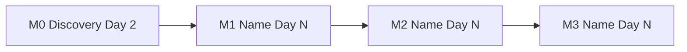

# Effort Breakdown Analysis - [Project Name]

**Date:** [Today's Date]
**Status:** Draft — Awaiting Engineer Sign-off
**Prepared by:** [Author / Team]

---

## Table of Contents

- [Executive Summary](#executive-summary)
- [Requirements](#requirements)
- [Solution Options](#solution-options)
- [RAD Analysis](#rad-analysis)
- [Tradeoff Matrix](#tradeoff-matrix)
- [Recommendation](#recommendation)
- [Milestones](#milestones)
- [Bottom-up Task Table](#bottom-up-task-table)
- [Wait-Time Assumptions](#wait-time-assumptions)
- [Technical Breakdown](#technical-breakdown)
- [Why These Numbers](#why-these-numbers-estimation-rationale)
- [Engineer Updates](#engineer-updates)

---

## Executive Summary

> Written for PMs and senior leadership. No repo names. No technical jargon.

[1–2 sentences: what is being built, why it matters to the business, and which solution approach was chosen.]

| | |
| :--- | :--- |
| **Business Goal** | [e.g. Reduce checkout drop-off by 15%] |
| **Chosen Approach** | [Solution name — one sentence on what it is] |
| **Success Criteria** | [How we'll know this is done] |
| **Business Systems Affected** | [Plain-language names — e.g. Checkout Flow, Payment Processing] |
| **Core Engineering** | [X days raw] + [Y days 20% buffer] = [Z days] |
| **Operational** | [X days — setup, infra, access] |
| **Rollout** | [X days — demos, reconciliation, UAT, training] |
| **Total Focused Days** | [Core Engineering incl. buffer + Operational + Rollout] |
| **Elapsed Working Days** | [Total focused ÷ 0.65 focus factor] |
| **Final Milestone Date** | [Day N — running total of working days from day 0; excludes waiting] |
| **Overall Confidence** | [High / Medium / Low] |
| **Risk Summary** | [One sentence. Review delays (Legal, Security) are the biggest schedule risk — see Wait-Time Assumptions. e.g. "One milestone also carries high risk due to legacy auth layer."] |
| **Key Assumptions** | [e.g. "Staging access available; v2 payments endpoint is idempotent"] |
| **Hard Dependencies** | [e.g. "Payment service schema migration must complete before M2"] |

---

## Requirements

> The agreed-upon problem definition. Locked before solutions were evaluated.

### Use Cases

| Actor | Action | Goal |
| :--- | :--- | :--- |
| [e.g. Logged-in user] | [e.g. Saves payment method at checkout] | [e.g. Faster repeat purchases] |

### User Stories

- As a [role], I want to [action] so that [outcome].

### Acceptance Criteria

- [ ] [Specific, testable condition — e.g. "Payment method saved successfully shows confirmation within 2s"]
- [ ] [...]

### Success Metrics

- [Measurable outcome — e.g. "Checkout completion rate ≥ 85% in staging load test"]

### Constraints

- [Non-negotiable — e.g. "Must not store raw card data — use tokenization only"]

### Scope

**In scope:**
- [Feature or capability included in this phase]

**Out of scope:**
- [Adjacent thing explicitly excluded — e.g. "Admin reporting dashboard (Phase 2)"]

---

## Solution Options

> Each option is a distinct functional design. The chosen approach is marked.

### Option A — [Name] ✅ *(Chosen)*

[2–3 sentences: what this solution does and how it addresses the requirements.]

**Repo / service impact:**
- `[repo/service]` — [what changes]
- `[repo/service]` — [what changes]

**Key trade-off:** [The main thing accepted with this approach]

---

### Option B — [Name]

[2–3 sentences: what this solution does and how it addresses the requirements.]

**Repo / service impact:**
- `[repo/service]` — [what changes]

**Key trade-off:** [The main thing accepted with this approach]

---

### Option C — [Name] *(if applicable)*

[Description]

**Repo / service impact:**
- `[repo/service]` — [what changes]

**Key trade-off:** [The main thing accepted]

---

## RAD Analysis

> The "no surprises" section. Source column shows where each item came from. Solution column shows which option(s) it affects.

### Risks

| Risk | Source | Solution(s) Affected | Affected Milestone | Mitigation |
| :--- | :---: | :---: | :---: | :--- |
| [Description] | Transcript / PRD / Engineer | A / B / All | M[N] | [Concrete step — e.g. "Spike 1 day on legacy auth before M1 is locked"] |

### Assumptions

| Assumption | Source | Solution(s) Affected | Owner | Must be confirmed by |
| :--- | :---: | :---: | :--- | :--- |
| [e.g. "Staging environment accessible to all engineers"] | Engineer | All | Platform team | Before M1 start |

### Dependencies

| Dependency | Type | Source | Solution(s) Affected | Blocks | Status |
| :--- | :---: | :---: | :---: | :--- | :--- |
| [e.g. `billing-engine` schema migration complete] | Internal | Transcript | A, B | M2 | Waiting |
| [e.g. Stripe API key rotation approved] | External | Engineer | A | M3 | Pending |

### Out of Scope (confirmed)

- [Item and rationale — e.g. "Admin dashboard: separate backlog item, no dependency on this work"]

---

## Tradeoff Matrix

> Comparison of all solution options across the dimensions that matter for this project.

| | [Option A] | [Option B] | [Option C] |
| :--- | :--- | :--- | :--- |
| **Effort** | [Low/Med/High — brief reason] | ... | ... |
| **Risk exposure** | [RAD items inherited] | ... | ... |
| **Repo impact breadth** | [Narrow / Moderate / Broad] | ... | ... |
| **Meets all requirements** | Yes / Partially — [gap] | ... | ... |
| **Long-term maintainability** | [signal] | ... | ... |
| **Key trade-off** | [what you give up] | ... | ... |

[2–3 sentences of narrative: what the table doesn't capture — team familiarity, reversibility, sequencing implications.]

---

## Recommendation

**Chosen approach: [Option Name]**

[2–3 sentences: why this solution best fits the requirements given the constraints, risks, and team context. Be direct about the trade-off being accepted.]

**Main risk accepted:** [One honest sentence about what could still go wrong.]

---

## Milestones

> Each milestone puts something usable in a named stakeholder's hands. Effort is **focused working days only**: no waiting. Dates are a running total of elapsed working days from day 0 and exclude waiting; see [Wait-Time Assumptions](#wait-time-assumptions). Evidence tags: **said** · **inferred** · **assumed** · **from vendor docs**.

| # | Milestone | Usable by [stakeholder] | AC met | Core Eng | Buffer 20% | Operational | Rollout | Focused days | Elapsed days | Date | Confidence | Risk |
| :---: | :--- | :--- | :--- | :---: | :---: | :---: | :---: | :---: | :---: | :---: | :---: | :---: |
| M0 | Discovery | [Decisions and scope locked] | n/a | [X, max 2 total] | none | n/a | n/a | [X] | [X] | Day [N] | High/Med/Low | 🟢 |
| M1 | [Name] | [What they can use] | [AC] | [X] | [0.2X] | [Y] | [Z] | [sum] | [sum ÷ 0.65] | Day [N] | High/Med/Low | 🔴/🟡/🟢 |
| M2 | [Name] | [What they can use] | [AC] | [X] | [0.2X] | [Y] | [Z] | [sum] | [sum ÷ 0.65] | Day [N] | High/Med/Low | 🔴/🟡/🟢 |

**Totals:** Core Engineering [raw] + [buffer] = [Z] · Operational [sum] · Rollout [sum] · Focused [sum] · Elapsed [sum ÷ 0.65] · **Final date: Day [N]** · **Overall confidence: [level]**

**Risk legend:** 🔴 High · 🟡 Medium · 🟢 Low



### AI-assisted workflow notes

No blanket discount is applied. Where Claude drafts code and tests, human time still goes to: [e.g. clarifying requirements, choosing the approach, reviewing generated work, validating behavior, security and integration checks, with the milestones affected].

---

## Bottom-up Task Table

> The task-level basis behind the milestones. Totals must reconcile.

| Milestone | Task | Bucket | Focused days | Basis | Certainty |
| :---: | :--- | :---: | :---: | :--- | :---: |
| M1 | [Task] | Core Eng / Operational / Rollout | [X] | [Why this number — **said** / **inferred** / **assumed** / **from vendor docs**] | High/Medium/Low |

**Reconciliation:**

| Milestone | Core Eng tasks = milestone | Operational tasks = milestone | Rollout tasks = milestone |
| :---: | :---: | :---: | :---: |
| M1 | [sum] = [sum] ✅ | [sum] = [sum] ✅ | [sum] = [sum] ✅ |

---

## Wait-Time Assumptions

> Waiting is **not** in the dates. Each wait below is an assumption the dates depend on, and says which dates slip day for day if it runs late. **Review delays (Legal, Security) are the biggest schedule risk.**

| Milestone | Wait | Assumed duration | Depends on | Evidence | Dates that slip day for day |
| :---: | :--- | :---: | :--- | :---: | :--- |
| M1 | [e.g. Security review] | [e.g. 3 working days] | [e.g. Security team] | assumed | M1, M2, M3 |
| M1 | [e.g. Vendor sandbox access] | [e.g. 2 working days] | [e.g. Vendor reply] | said | M1, M2, M3 |
| M3 | [e.g. Pilot run] | [e.g. 5 working days] | [e.g. Pilot users] | assumed | M3 |

**If all waits land as assumed:** [final date + sum of waits on the path = Day N]. This is a scenario, not the plan; the plan dates above stay wait-free.

**Biggest wait-time risk:** [The wait most likely to run longer than assumed and which dates it moves.]

---

## Technical Breakdown

> For engineers. One section per repo for the chosen solution. Enough context to start, not a full spec.

### `[repo-name]`

**Business system:** [Plain-language name — e.g. Payment Processing]
**Milestones:** M1, M2
**Design decision:** [e.g. "Sync API call over event bus — existing service calls here are all synchronous and async infra isn't in place"]

| Area / File | Change needed | Rationale |
| :--- | :--- | :--- |
| `src/domain/service.go` | [What to add or change] | [Why — ties to requirement or RAD risk] |
| `src/api/handler.go` | [What to add or change] | [Why] |

**Testing required:**
- [ ] Unit tests for [component]
- [ ] Integration test for [flow]

---

### `[repo-name-2]`

**Business system:** [Plain-language name]
**Milestones:** M2, M3
**Depends on:** `[repo-name]` completing M1 first

| Area / File | Change needed | Rationale |
| :--- | :--- | :--- |
| `config/schema.sql` | [What to add] | [Why] |

**Testing required:**
- [ ] [Test type and scope]

---

## Cross-Repo Dependency Map

> Only present when multiple repos are in scope (`--root` mode).

```
M1: [repo-a] — [deliverable]
  └─► M2: [repo-b] — depends on [repo-a] M1 completing first
        └─► M3: [repo-a] + [repo-b] — [deliverable]
```

**Sequencing risk:** [Note any milestone where a delay in one repo cascades to others]

---

## Why These Numbers: Estimation Rationale

> For PMs and Leadership. Explains the reasoning behind the effort estimates — not just what we built, but why the numbers are what they are.

### What the estimate is actually measuring

Software estimates often feel like guesses because the hardest part isn't writing the code — it's everything around it. The numbers in this document account for:

- **Understanding and design time** — Before any code is written, the engineer needs to deeply understand the existing system, identify the right integration points, and make design decisions that won't create problems later. This is invisible work that PRDs never capture.
- **Integration and coordination overhead** — [Specific to this project: e.g. "This feature touches 3 services that weren't originally designed to work together. Every integration point requires reading, testing, and validating behavior across system boundaries — not just writing new code."]
- **Validation and review** — [Specific to this project: e.g. "Changes to the payment flow require security review, edge case testing, and sign-off from multiple stakeholders. The code might be written in hours; getting it production-ready takes days."]
- **The 20% buffer** — Applied to Core Engineering only. This isn't padding — it's the empirical gap between "it works in dev" and "it's ready to ship." It accounts for the bugs found in code review, the edge cases surfaced in QA, and the config that only breaks in staging.

### Why this milestone is sized the way it is

| Milestone | Key sizing rationale |
| :--- | :--- |
| M1 | [e.g. "Larger than it looks — the schema migration requires careful rollback planning and coordination with Platform before we can safely run it in production"] |
| M2 | [e.g. "This is the riskiest milestone. The legacy auth integration has no existing tests, so we're building blind until we write them ourselves — that's where most of the estimate lives"] |
| M3 | [e.g. "Rollout is non-trivial because we're doing a gradual flag ramp across user cohorts, not a single deploy. Each increment requires monitoring and a manual sign-off before the next one"] |

### What would make these numbers wrong

These estimates hold **if** the assumptions in the RAD section stay true. The things most likely to change the timeline:

- [e.g. "If the legacy auth service requires a contract change, M2 expands significantly — that negotiation alone could add a week"]
- [e.g. "If staging access isn't provisioned before M1 starts, the entire sequence shifts right"]
- [e.g. "If the external API rate limits are lower than documented, we'll need an additional caching layer that isn't scoped here"]

### How to read the effort buckets

All three buckets count **focused working days only**: time an engineer is actively working on the task. Waiting is never included in effort or dates; it lives in Wait-Time Assumptions.

- **Core Engineering** days = design, code, review, writing tests, and debugging. Time waiting for someone else's review is not included.
- **Buffer** = 20% added to Core Engineering only, shown in its own column. It is the gap between "it works in dev" and "it's ready to ship."
- **Operational** days = hands-on setup, infra, access, and config work. Waiting on provisioning or approvals is not included.
- **Rollout** days = hands-on demos, reconciliation, UAT, and training. Pilot runs, soak time, and sign-off waits are not included.
- **Elapsed days** = focused days ÷ 0.65 focus factor, which allows for meetings, context switching, and interruptions.
- **Dates** = running total of elapsed working days from day 0, with no waiting. If a wait assumption runs late, the dates listed beside it slip day for day.

---

## Engineer Updates

> Living document. Engineers: log estimate changes here as you uncover more context. PMs: check this table for the most current delivery picture.

| Date | Engineer | Milestone | What changed / Why | Core Eng | Operational | Rollout | Dates affected |
| :--- | :--- | :---: | :--- | :---: | :---: | :---: | :---: |
| | | | | | | | |
