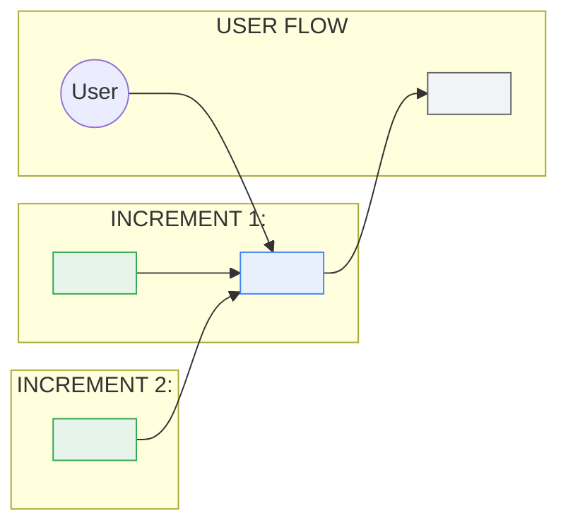
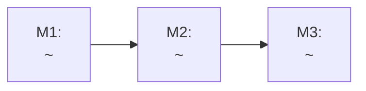

# <Feature name>: PRD and Technical Design

## Glossary (shared vocabulary)

| Term / field | Meaning | Notes |
| --- | --- | --- |
| <term> | <one-line meaning> | <retired names, source of the name> |

**Increments:** Increment 1 = <label>. Increment 2 = <label>.
**Options:** Option 1 = <label> (Selected starting point). Option 2 = <label> (Fallback).
**Ownership tags used in diagrams:** external system, new build, existing system.

---

# Part 1: Product Requirements

## 1. Executive Summary & Value Proposition
<2 to 4 sentences: what we are building, for whom, and the split into increments.>

### Core Value Drivers
- **<Driver>:** <one sentence>.

## 2. High-Level Integration Visual Workflow
<One sentence on what the diagram shows.>

## 3. General & Business Requirements

| Category | Details |
| --- | --- |
| <category, e.g. timeline, approvals, analytics, dependencies, future scope> | <details; flag anything unconfirmed> |

### 3.1 Non-Functional Requirements
- **NFR-1 (<Short title>):** <requirement>.

## 4. Functional Requirements

### 4.1 <Capability> (<new build | existing>, Increment 1)
- **FR-1.1:** <behavior in plain language>.
- **FR-1.2:** <behavior>. (Proposal, to be confirmed.)

### 4.2 <Capability> (Increment 2)
- **FR-2.1:** <behavior>.
- **FR-2.2 (Option 1, starting point):** <behavior>.
- **FR-2.3 (Option 2, fallback):** <behavior>. Use Option 2 only if one of these holds:
  - <move trigger>

## 5. Architectural Design (overview)
- **<Component> (Increment 1):** <one-line responsibility>.
- **<Component> (Increment 2, Option 2, fallback):** <one-line responsibility>.

---

# Part 2: Technical Design

## 1. Overview
<2 to 3 sentences restating the increments and the selected starting point.>

## 2. <Design topic driven by a requirement area> Options (covers FR-x.x, NFR-x)

### 2.1 Option 1: <label> (Selected starting point)
- **Mechanism:** <how it works, plain language>.
- **Why start here:** <reasons>.
- **Trade-off:** <the cost we accept>.
- **Guardrails:** <limits, retries, alerts>.
- **Still to confirm:** <open items with owner>.
- **Measure before launch:** <numbers that decide whether this holds>.

### 2.2 Option 2: <label> (Fallback)
- **Move here only if:** <same triggers as FR-2.3, same wording>.
- **Mechanism:** <short description>.
- **Baseline:** <current metrics, with date range>.

## 3. Tradeoff Analysis & Discarded Alternatives

| Option | Pros | Cons | Decision |
| --- | --- | --- | --- |
| <Option 1> | <...> | <...> | Selected starting point |
| <Option 2> | <...> | <...> | Fallback, if the move triggers are hit |
| <Alternative> | <...> | <...> | Discarded: <reason> |

## 4. Roadmap: After Increment <n> Launch
- **<Option> follow-ups:** <next steps and what decides them>.

## 5. References & External Documentation
- [<Title>](<url>): <what it is for>.

---

# Part 3: Estimate (omit with `--no-estimate`)

Estimated for an AI-assisted workflow. AI speed-up is an assumption to validate, not a built-in discount.

## Milestones at a glance

| Milestone | What you can see or demo when it is done | Covers | Effort (heads-down) | Main risk |
| --- | --- | --- | --- | --- |
| **M1: <name>** | <one plain sentence> | FR-1.1, NFR-1 | <e.g. 1 to 2 weeks> | <one line> |
| **M2: <name>** | <one plain sentence> | FR-2.1 | <range> | <one line> |
| **Total** | | | <sum of ranges> | |

## Where the human time goes
- **AI-assisted:** <work Claude can likely draft, e.g. boilerplate, tests>.
- **Human judgment:** <decisions, review, validation, integration, security>.

## Waits (not heads-down effort)
- <External dependency or approval>: <owner>, blocks <milestone>.

---

## Open Items
- <Unconfirmed item>: <owner>, <what it blocks>.
